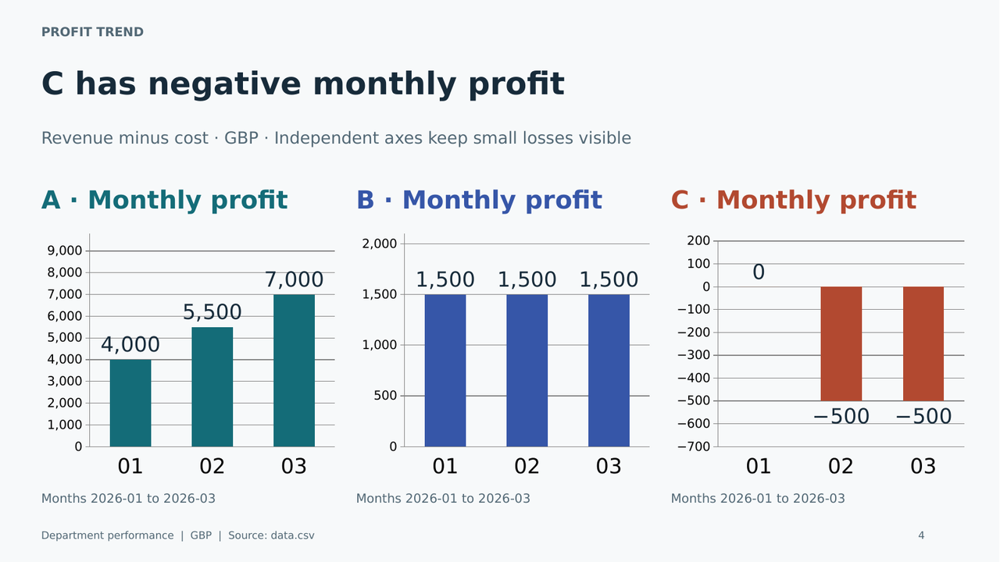

# My figures need a presentation

**I turned department figures into an editable deck with reconciled charts.**

The input is a nine-row figures file I wrote for this case. I rendered and checked the deck in LibreOffice; Microsoft PowerPoint and Excel were not run.

<a href="output/slides/slide-04.png"></a>

*Slide 4 of the deck as LibreOffice rendered it. Department C is the one with a loss: profit 0 in January, minus 500 in February and March.*

## What was wrong

- The figures were rows, without a presentation to explain them.
- Revenue alone hid a department’s loss.
- Manually copying totals would make updates hard to check.

## What I did

- I gave each slide a single takeaway and a consistent layout.
- I built editable charts with their own editable spreadsheets.
- I kept department colours consistent and showed zero and negative profit.
- I reconciled the plotted values with the source, then reviewed the LibreOffice renders.

## Proof and downloads

The [source rows](input/data.csv) for department C (lines 4, 7 and 10) and the [crop of its chart](output/chart-detail.png) show the same periods as the slide above. [The map](output/hero-map.json) identifies the source lines and slide. The [contact sheet](output/contact-sheet.png) shows all five slides. Chart month labels are month numbers; the year is printed below the chart.

| Measured result | Evidence |
|---|---|
| Editable slides | [5 slides, 7 native charts](output/report.json) |
| Source figures | [9 rows, 3 departments, 3 periods](input/data.csv) |
| Reconciled totals | [GBP 90,000 revenue − GBP 70,000 cost = GBP 20,000 profit](output/report.json) |

Measured from the shipped PPTX and embedded workbooks with [python-pptx 1.0.2 and Python 3.11.2](output/report.json); PDF checked with [pypdf 5.1.0](output/report.json). The [source-to-chart map](output/source-map.json) retains the input line numbers.

**Downloads:** [editable PPTX](output/deck.pptx) · [PDF deck](output/deck.pdf) · [all slide previews](output/contact-sheet.png) · [source CSV](input/data.csv) · [deck settings](input/deck.json) · [check report](output/report.json) · [runtime](output/runtime.json).

Rendered and reviewed in [LibreOffice](output/report.json). Microsoft PowerPoint and Excel were not run.

## Try it yourself

Install Git and Docker, clone [the repository](https://github.com/Ardholt/doc-pipeline), then run from its root:

```bash
cd data-to-powerpoint && ./run.sh
```

Open `output/deck.pptx` or `output/deck.pdf`. See [input format and replacement-directory options](source/USAGE.md) for your own figures. Docker downloads the pinned dependencies during setup; document processing runs offline.

## How it is tested

[](https://github.com/Ardholt/doc-pipeline/actions/workflows/checks.yml)

The [checks](tests/check.py) read actual chart values and embedded spreadsheets, compare them with exact source totals, and check colours, order, visible totals, metadata and file hashes. The [damage checks](tests/regression.py) require corrupt values and invalid inputs to fail. To inspect existing output without conversion, run `./run.sh --check`.

[Page previews](https://github.com/Ardholt/doc-pipeline/blob/main/data-to-powerpoint/proof/page-previews/screenshots.json) use the shared offline GitHub frame and Pages layout. They are local renders, not captures of the published pages; CI status comes from the badge above.

---

Fixed price in a written scope, sent within hours

Maintained by Genco Doganay, Ardholt · [All cases](../README.md) · [MIT licence](../LICENSE)
