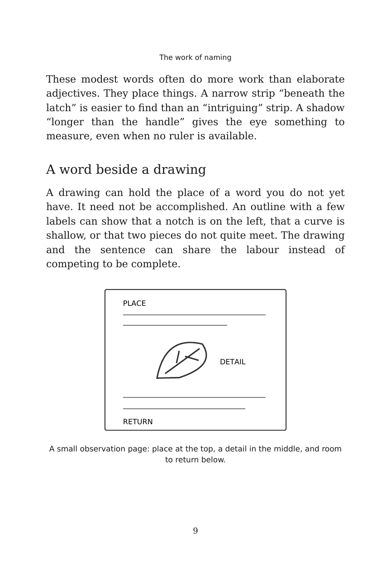

# My eBook needs a properly laid-out print PDF

**I turned the manuscript into a print interior.**

The input is a six-chapter manuscript I wrote for this case. I laid it out with Pandoc and WeasyPrint and checked the PDF with Poppler and pypdf; printer upload and a physical proof were not tried.

<a href="output/details/page-09.png"></a>

*Page 9 of the finished interior PDF, rendered unedited. The [contact sheet](output/contact-sheet.png) shows all 26 pages.*

## What was wrong

The manuscript was a Markdown text file with no page layout. The [before file](output/before.pdf) is that raw Markdown, symbols and all, printed in 9 pt monospace on pages of the same trim size.<br>
Chapter openings, running heads and page numbers needed a layout.<br>
The finished PDF needed checking against the original words.

## What I did

- I wrote and laid out *The Unhurried Notebook*.
- I set the trim, safe margins, running heads and page numbers.
- I placed chapter openings on right-hand pages and notes at the foot of the page.
- I checked the cleaned PDF against the manuscript and rendered every page.

## Proof and downloads

[Download the print interior](output/interior.pdf) · [Download the manuscript](https://raw.githubusercontent.com/Ardholt/doc-pipeline/main/ebook-print-pdf/input/manuscript.md) · [Print settings](input/print.json)

[Before formatting](output/before.pdf) · [Full before/after pages](output/page-pair.png) · [All-page contact sheet](output/contact-sheet.png) · [Detailed page renders](output/render-map.json)

The [PDF report](output/report.json), measured with the tool versions recorded there, covers page geometry, embedded fonts, source text, notes and links. [Source-to-page map](output/source-map.json) · [Geometry and fonts](output/geometry.json) · [Runtime](output/runtime.json) · [Claim evidence](proof/claims.json).

- [26 pages](output/report.json), counted with pypdf 5.1.0.
- [152.4 × 228.6 mm trim, no bleed](output/geometry.json), measured from PDF boxes with pypdf 5.1.0.
- [18 mm safe margins](output/report.json), checked with Poppler 22.12.0 text bounds, and [11 pt as the size of the manuscript's paragraph text](output/report.json) (`body_type_size`: the paragraph text between running head and page number, read from pypdf 5.1.0 font operators).
- [6 chapter openings and 6 footnotes](output/source-map.json), matched using Pandoc 2.17.1.1 and Poppler 22.12.0.
- [4 embedded font resources](output/geometry.json), inspected with pypdf 5.1.0.
- [0 missing source blocks](output/report.json), compared using Pandoc 2.17.1.1 and Poppler 22.12.0 with the documented text normalization.

[Opening page](output/details/page-03.png) · [Illustration and caption](output/details/page-09.png) · [Closing page](output/details/page-26.png). The first-screen image is page 9 of the [finished PDF](output/interior.pdf) as rendered by Poppler; the [render map](output/render-map.json) names its source file. For the raw Markdown, [the first page of the before file beside the finished chapter opening](output/page-pair.png) shows what the manuscript looked like as a print (9 pt monospace, symbols visible).

This is an interior, with no cover. Printer upload, PDF/X certification and a physical proof have not been tested.

## Try it yourself

Clone the repository and install Docker, then run from its root:

```bash
cd ebook-print-pdf && ./run.sh
```

Open `output/interior.pdf`. The build runs offline after dependency installation. See [input and layout boundaries](source/README.md) for replacement manuscripts and output-only checks.

## How it is tested

[](https://github.com/Ardholt/doc-pipeline/actions/workflows/checks.yml)

The checker reads the actual PDF boxes, font resources, text positions and content. It compares the output with the manuscript, checks chapter starts and notes, and checks file hashes. [Test source](https://github.com/Ardholt/doc-pipeline/blob/main/ebook-print-pdf/tests/check.py) · [Build checks](proof/validation.json) · [Visual review](proof/visual-review.json).

[Phone and desktop page previews](https://github.com/Ardholt/doc-pipeline/blob/main/ebook-print-pdf/output/page-previews/screenshots.json) are offline renders in a local GitHub-style frame and the Pages layout, not captures of the published pages; CI status comes from the badge above.

---

Fixed price in a written scope, sent within hours

Maintained by Genco Doganay, Ardholt · [All cases](../README.md) · [MIT licence](../LICENSE)
