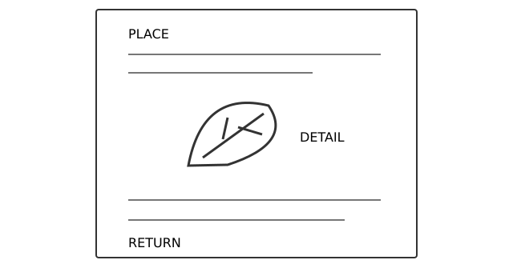

# A first look

Begin with a detail.

A notebook does not need to begin with an important thought. It can begin with the pale rectangle left on a table when a cup is moved. The wood beneath the cup is dry; the wood around it holds a fine mist. For a moment, a familiar surface has become a map. Then a sleeve passes over it and the map is gone.

I used to wait for a subject before opening a notebook. A subject seemed to be something with a proper name, a date, and a reason to remember it. Ordinary mornings offered none of these. They offered a changing window, a spoon that would not lie flat, and the sound of water working through a pipe. By the time I decided whether these things deserved a sentence, I had forgotten what made me notice them.

The change was small. I stopped asking whether an observation mattered and began asking whether I could describe it accurately. That question gave the page a manageable task. Instead of accounting for the morning, I could record one edge of it. The cup had left a square of dry wood because it was standing on a folded cloth. The mist was not mist at all, but tiny droplets from a rinsed leaf. Accuracy made the scene stranger and more interesting than my first impression.

## Begin with a boundary

Choose a small area to look at: a windowsill, a single shelf, the space within reach of one hand. A boundary keeps the eye from searching for something more impressive. Stay inside it long enough to see relationships. Which object touches another? Where does the light stop? What has been placed deliberately, and what has merely come to rest?

A page can hold the same kind of boundary. Write the place at the top, using an ordinary description rather than a full address. Then write what you can actually see. If the object is blue, ask which part is blue. The handle may be darker than the bowl. If it looks old, find the visible evidence: a polished rim, a shallow chip, a place where paint has worn smooth. An adjective should open the view rather than close it.

One useful beginning is a sentence with no interpretation in it. “A loose thread catches against the hinge.” There is no lesson attached to that thread. It does not have to stand for persistence or neglect. The sentence can remain a record of a material encounter. If a larger thought follows, it will have somewhere solid to stand.

> Stay with the thing until the first easy word has passed.

This is a working invitation, not a demand for perfect attention. Some days the easy word is all that arrives. Keep it, put a small mark beside it, and return when you can. The notebook is allowed to show the distance between a first glance and a second one.[^glance]

## The first useful page

Start with a few actions that can be finished before the room changes:

1. Name the place in a short phrase.
2. Describe one object without saying whether you like it.
3. Record a change that happens while you watch.
4. Leave a little room beneath the entry.

The spare room matters. It gives a later thought somewhere to go without requiring you to rewrite the earlier one. A note added beneath an entry can disagree with it. The notebook then records attention moving, rather than pretending that the first version was complete.

On the windowsill, a line of dust may look grey until the light reaches it. Then it contains bright fibres, dark grains, and one hair bent almost into a circle. You do not need to catalogue each piece. Choose the detail that changes the whole view. “The grey line breaks into separate colours in sunlight” is enough to bring the sill back to mind.

Before closing the book, read the entry once. Look for a word that points vaguely at something the sentence could name. Replace “there” with “under the rim” if that is what you mean. Replace “nice” with the particular arrangement that pleased you. Do not polish away your uncertainty. “Perhaps” can be an exact word when the evidence is incomplete.

An entry may end without a conclusion. The cup will be moved again. The thread will come free or remain caught. You are not responsible for supplying the scene with a final meaning. You have kept one small part of it from passing unnoticed, and you have practised finding language close enough to touch what was there.

[^glance]: A second look need not correct the first. It can add a different distance, a later light, or a detail that was previously hidden.

# The work of naming

There is a difference between not knowing a name and not seeing an object. A plant on a landing can be carefully observed even when its species is unknown. Its newest leaf may still be folded like a narrow envelope. A dry stem may lean against the wall. The pot may turn slightly every time the door opens. These are available facts, and none of them depends on a label.

A name becomes useful when it helps you return. It gives a detail a place in memory, or lets you distinguish it from its neighbours. It becomes less useful when it ends the looking. The word “plant” can hide as much as it reveals. So can a precise botanical term, if learning it makes you feel that the work is finished.

In a notebook, temporary names are often enough. The bent leaf. The shallow dish. The narrow patch of light behind the chair. These phrases are local tools. They need not work for every reader in every room. They need only make the observation recoverable without pretending to know more than you do.

## Names that leave room

Try describing an unfamiliar object before looking up its name. Record its shape, surface, position, and any motion you can see. Then, if you later discover a reliable name, add it beneath the description. Keep the earlier language. It shows which features first drew your attention, and which features a reference source taught you to distinguish.

The order is useful because the two kinds of knowledge do different jobs. Direct looking tells you what this object is doing here. Reference knowledge may tell you what objects of this kind tend to do. Neither should silently replace the other. A book can say that a surface is usually smooth while the particular surface in front of you is pitted and rough.

Words for colour deserve the same care. “Green” is a starting point. You might add that the leaf is darker at its centre, or that its underside looks almost silver when turned towards the window. Comparisons can help, provided they do not become a second puzzle. A colour compared with another obscure colour has not become clearer.

Keep a small vocabulary of relationships:

- against, beneath, beyond;
- wider than, lighter than, close to;
- folded towards, resting on, turning away from;
- before, during, just after.

These modest words often do more work than elaborate adjectives. They place things. A narrow strip “beneath the latch” is easier to find than an “intriguing” strip. A shadow “longer than the handle” gives the eye something to measure, even when no ruler is available.

## A word beside a drawing

A drawing can hold the place of a word you do not yet have. It need not be accomplished. An outline with a few labels can show that a notch is on the left, that a curve is shallow, or that two pieces do not quite meet. The drawing and the sentence can share the labour instead of competing to be complete.

The diagram shows a possible arrangement, not a rule for every entry. Sometimes the drawing needs the whole page. Sometimes a single sentence is enough. What matters is that you can tell where the observation ends and where a later question begins. A dividing line can be more helpful than an elaborate system of symbols.

When a word seems nearly right, write down why it is not quite right. Perhaps “cracked” suggests a break all the way through, while the mark you can see is only on the glaze. Perhaps “faded” suggests that a colour has changed, when you have never seen it before. This kind of hesitation is productive. It keeps an inference from dressing itself as a fact.[^name]

The notebook can accommodate names in more than one language, accents, and unfamiliar marks. Keep the spelling that belongs to the thing you are recording. A café sign and a cafe sign are not identical strings, even if you understand both. The small marks are part of the visible material. Attention includes them.

At the end of an entry, ask which word helped you see and which word allowed you to stop seeing. You will not always be able to separate them. That uncertainty is worth keeping. Over time, the page becomes a record of your vocabulary changing under the pressure of particular things.

[^name]: An inference is a conclusion drawn from what is visible. Marking it as an inference keeps the observation available for another explanation.

# A walk with a small radius

A walk for noticing does not need a destination. It needs a limit that can be held lightly. The limit might be the point where a path changes surface, or the place where the shade ends. With a small radius, there is less temptation to hurry towards an imagined better view. The walk can deepen without becoming longer.

Begin by choosing something that repeats. It might be joints between paving slabs, leaves caught along a fence, or patches where rain has darkened stone. Repetition gives variation somewhere to appear. A single joint is easy to overlook. Several joints, each holding a different amount of grit, become a sequence that can be read.

Walk at an ordinary pace until something interrupts it. Do not manufacture the interruption. A change of sound may be enough. Gravel under a shoe, then a smooth surface, then the hollow note of a loose board: the route has a texture even when your eyes are occupied elsewhere. Stop where it is safe and write the sequence while you can still hear its order.

## Carry less

A notebook that is awkward to reach will stay closed. Carry it where you can take it out without rearranging everything else. A pencil may be enough. Extra colours, measuring tools, and reference books can be useful for a particular task, but they also make it easier to spend the walk preparing to observe.

The first note can be extremely brief. “Light only on the upper edge.” Add the object when you stop: “Light only on the upper edge of the low wall.” Add the cause only if you can see it: “A projecting branch shades the face.” The entry grows from a trace into a sentence without requiring you to write a finished paragraph while standing outside.

Do not record private conversations or identifying details about people passing by. There is plenty to notice in surfaces, weather, plants, and the shape of a route. If a person changes the scene, describe the change without turning them into a subject. A gate swings, a shadow passes, the path becomes clear again. The observation can remain about the place.

> A short route can contain a long sequence of differences.

This is especially apparent on the way back. The same surface catches light at another angle. A slope that felt gentle in one direction asks more of your legs in the other. The return is not a duplicate of the outward walk. It is a second arrangement of the same materials.

## Put the route on a page

A route can be recorded without drawing a conventional map. Make a vertical line and place brief notes along it in the order they occurred. Use spacing to suggest pauses, but do not let it imply measured distance unless you measured it. The page is a sequence of attention, not a surveying instrument.

For a short route, the entries might read:

1. Dry leaves gathered at the first change of surface.
2. A darker strip beneath the overhanging edge.
3. Water moving through a shallow groove.
4. The same groove empty on the return.

The last entry changes the meaning of the earlier one. The groove was carrying a temporary flow, not holding a permanent pool. A second pass supplies information that a longer outward walk might never have given you. Returning is an active part of looking.

If you cannot stop to write, choose one detail to remember rather than trying to retain the entire route. Repeat its description silently until you reach a suitable place. Then write it down and mark that the wording was reconstructed after the walk. This is not a failure of observation; it is an honest account of how the entry was made.[^route]

Back indoors, resist the urge to turn every note into a smooth story. A list of changes may preserve the walk better than a narrative with an invented beginning and ending. Add a sentence about the conditions if it helps: low sun, damp ground, little wind. Keep the conditions separate from any larger claim about the place.

On another day, follow the same radius. You may notice less at first because the route feels familiar. Stay with it. Familiarity removes the spectacle of arrival and makes quieter differences available. A branch has shifted. The groove is dry. A leaf that seemed fixed has moved to the other side of the path. The walk has remained small, but the record has begun to acquire depth.

[^route]: Memory can preserve an impression while changing its wording. Distinguish a note made on the spot from one written afterwards when that difference matters.

# Returning to the same place

The first visit gives you a scene. A return gives you a relationship. The object is still there, but you are no longer meeting it without a previous version in mind. You compare, sometimes before you realise you are comparing. The notebook can make that process visible by keeping the earlier entry close enough to consult and far enough away to question.

Choose a place that is easy to revisit. A shelf near a window is enough. You do not need a dramatic landscape or a rare event. A reachable place lets you observe at different moments without making each return into an expedition. The practical ease matters because attention is more likely to continue when it fits into an ordinary day.

On the second visit, look before opening the old entry. Write a few fresh lines. Then read what you wrote earlier. This order helps you avoid searching only for details that the previous page has already approved. It also reveals which features return to your attention without assistance.

## Similar is not unchanged

Two entries may look almost identical. That does not mean nothing happened between them. It means the differences you could see were small, or that your method did not catch them. A notebook should leave space for both possibilities. “No visible change” says less than “unchanged”, and is often the more accurate phrase.

The light on a shelf can repeat while the air in the room feels different. A leaf can remain in the same position while its edge grows dry. An object can be moved away and returned to its old place. Looking gives you evidence of a moment, not a complete account of everything that led to it.

A useful return entry separates three kinds of statement:

- What is visibly different from the earlier record.
- What appears similar at the present distance.
- What cannot be compared because the conditions have changed.

The third kind is easy to omit. Yet a change in light can make a colour comparison uncertain, and a different viewpoint can hide the mark you meant to check. Recording these limits makes the comparison more useful. It prevents a neat page from claiming more than the observation supports.

## A slow sequence

Arrange several entries in the order they were made. Read only the concrete details first. Ignore your conclusions for a moment. You may discover that the conclusions moved quickly while the details changed slowly, or the reverse. A sequence lets you examine your own pace of interpretation.

Suppose a loose label curls a little further away from a jar. One entry calls it “peeling”; another says “lifting”; a later one describes a shadow under the lower edge. The third entry may be the most useful because it records something another look could confirm. The first two contain an implied process. The shadow contains a visible relationship.

There is no need to remove the earlier words. Put a line beneath the sequence and add what you now understand. A notebook can preserve an error without endorsing it. The correction becomes part of the record, showing what additional attention made possible.[^return]

Some returns will be disappointing. The light you hoped to see will not come. The object will have been moved. The path will be closed. Write the interruption briefly if it changes the record, then let the entry be short. A practice built around noticing must be able to notice absence without filling it with invented detail.

Returning also teaches you when to stop. If you are repeating the same sentence because the page expects something, close the book. The place does not owe you a development. You can come back when there is a question worth bringing, or when enough time has passed that the familiar surface may become visible again.

Before leaving the sequence, write one question that remains open. Make it small enough for another visit: does the shadow reach the lower corner; does the leaf turn towards the window; does the groove hold water after a light shower? A good question points your next look without deciding in advance what it must find.

[^return]: Keep a correction legible beside the original wording. Removing the earlier sentence can hide the reason for the later one.

# Making a page that can be found

A full notebook can become strangely inaccessible. You remember writing about a particular surface, but not where the entry sits. Turning pages brings back many other things and leaves the desired one just out of reach. A little structure helps, provided it does not become more demanding than the observations themselves.

Begin with what you already use. If you tend to remember places, give entries short place labels. If you remember materials, keep a list of those. If you remember questions, gather the questions. The best index follows the way you look for things rather than imposing a system that looks tidy from outside.

Leave the original entries where they are. An index is a route back, not a second copy of the notebook. A phrase and a page reference can be enough. Copying whole passages into categories often removes the context that made them interesting: the sentence before, the drawing beside them, the later correction in the margin.

## An index with ordinary words

Choose index terms that you are likely to remember after the particular mood of the entry has passed. “Window light” will probably be easier to find than “The brief brilliance”. The more lyrical phrase can remain in the entry. The index has a simpler job: it should help your hand reach the right page.

A small list might include:

- Light: sill, shelf edge, low wall.
- Water: leaf droplets, shallow groove, drying cloth.
- Surfaces: glaze, worn paint, polished wood.
- Questions: shadow length, leaf position, returning rain.

An entry may belong under more than one term. That is not disorder. It reflects the fact that observations connect in several directions. Use the smallest amount of repetition that helps you find them. You do not need to decide on a single correct home for a sentence about water shining on stone.

If you number the pages, do so consistently. If you use dates, make them unambiguous to your future self. If neither method suits the book, a few labelled tabs can provide rough regions. The system should survive a missed entry or an untidy page. A structure that breaks whenever you are distracted will not last long.

## Read across the entries

An index does more than retrieve. It lets you read together things that were observed far apart. Follow the entries under “edges” and you may find a cup rim, a torn leaf, a strip of shadow, and the lip of a shallow dish. Their differences become clearer when they share a page in your attention.

Write a short connecting note only after reading the entries themselves. Avoid announcing a pattern from memory and then gathering evidence to decorate it. The notebook is most useful when it can surprise you. Perhaps the entries do not support the pattern you expected. Perhaps the interesting connection lies in a word you kept using rather than in the objects.[^index]

A connecting note might begin, “I use ‘soft’ for both light and worn surfaces.” That sentence opens a question about language. It does not require you to claim that the objects are fundamentally alike. Another note might observe that you describe motion more precisely outdoors than indoors. The index has revealed a habit of attention.

Do not force every entry into the system. Some pages can remain unclassified. A strange fragment that does not fit may become useful later, or may simply remain itself. The notebook is a working collection, and a working collection benefits from a little room around its categories.

When you find an old entry, add a return mark if it helps. A small line in the margin can show that the page has been revisited. Avoid building a score from these marks. Frequently consulted entries are not necessarily better than quiet ones. They may simply answer the questions you happen to be asking now.

The point of finding a page again is to make contact with a previous act of attention. You recover not only the object but the particular way you looked at it. Sometimes that way still serves you. Sometimes it has become too narrow. The index gives you access to both possibilities without deciding which one you will meet.

[^index]: A connecting note is a new piece of writing. Keep it distinct from the observations it brings together, so a later reader can trace the connection.

# Leaving room for the next look

Near the end of a notebook, empty pages can acquire an unreasonable importance. You may feel that they need to contain your best observations, or that the final entry should explain the whole book. Neither demand comes from the paper. Both can make an ordinary practice harder to continue at the moment when it has become familiar.

Use the remaining pages as you used the first ones. Notice something available. Name the conditions. Keep the difference between what you saw and what you inferred. The book does not require a grand ending. It requires a stopping place from which you can return to the world without carrying a debt to the unfinished page.

A final reading can still be useful. Set aside the wish to judge the notebook as good or bad. Look instead for changes in what you were able to describe. Perhaps the early entries rely on broad adjectives while later ones contain positions and relationships. Perhaps the drawings became simpler because you learned which lines mattered. Perhaps uncertainty became easier to state.

## What to carry forward

Choose a few practices that made looking easier. Keep them small enough to remember without a set of instructions. You might carry forward the habit of leaving room beneath an entry, or looking before reading an earlier note, or separating a question from an observation. These are portable ways of working, not promises about how every future page must look.

You may also find practices worth leaving behind. A complicated symbol system might have slowed you down. A daily target might have produced entries written only to satisfy the target. An index category might have become so broad that it no longer helped you find anything. Letting these go is part of learning from the book.

> Keep the practice that returns your attention to the world.

The sentence is a useful test. If a method makes you think mostly about maintaining the method, simplify it. If it helps you notice a detail you would otherwise miss, keep it for a while. No arrangement has to be permanent. The notebook can change as the work changes.

## A place for unfinished questions

Before putting the book away, gather the questions that still feel alive. Do not copy every question. Some have already been answered, and some belonged to a moment that has passed. Choose those that still make you want to look. Put them on a page where you can find them when the next notebook begins.

An unfinished question might concern a material: how does this surface look when it is dry? It might concern a sequence: where does the first patch of light appear? It might concern your language: what do I mean when I call a sound distant? Each question gives the next look a direction without demanding a particular result.

Leave a little space after the list. The space acknowledges that a new question may arrive later. A notebook remains useful after it is full because reading it is another form of encounter. A sentence that seemed complete may become puzzling. A detail that seemed minor may turn out to be the one you need.[^ending]

The physical book will also change. Corners soften. A page may open more easily where you have returned often. These marks are another record of use, though they should not be mistaken for a measure of value. A pristine page can contain a careful observation; a heavily handled one can contain a mistake. The surface tells you about contact, not merit.

When you open a new notebook, you can begin without announcing a new project. There may be a pale rectangle on a table, a folded leaf, a line of dust broken into colours. Write the place. Describe the detail. Leave room. The first sentence does not need to justify the pages that will follow it.

What you carry from the old book is not a collection of conclusions so much as a way of approaching what is near. You have practised staying with an object after its familiar name arrives. You have learned that a return can change an observation, and that a correction can remain visible without spoiling the page. You have made room for the world to be a little less settled than your first glance suggested.

Close the cover when you are ready. The next thing worth noticing is unlikely to wait for a formal beginning. It may already be resting within reach, ordinary and exact, with one edge turned towards the light.

[^ending]: An open question is not an obligation. Keep it only while it continues to make another look possible.
