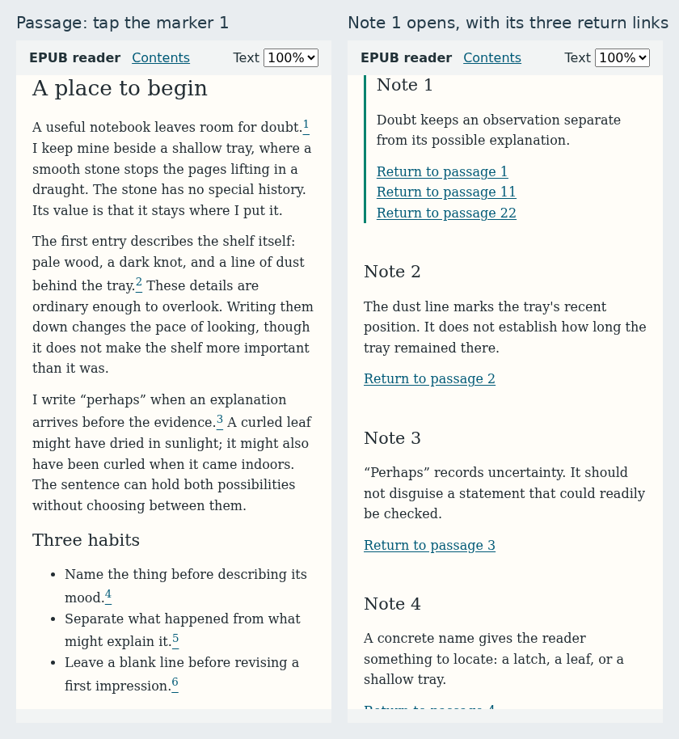

# Kindle notes won’t open

**I built EPUB notes that open and return in Chromium.**

[](media/hero.png)

Tested in a browser, not on a Kindle or the Kindle Previewer; neither was available to me. This proof is from a custom browser reader, not Kindle popup behaviour or KDP acceptance.

## What was wrong

- A visible note number does not give the reader a working link.
- A shared note needs a way back to each referring passage.
- A fixed page layout makes notes harder to read on a small screen.

## What I did

- I wrote the manuscript and built a reflowable book from it.
- I gave each marker a distinct destination for the return journey.
- I preserved the prose, Unicode, lists and note text, with whitespace normalization documented in the source map.
- I checked the packaged book and opened every note in the browser reader.

## Proof and downloads

| Check | Result |
|---|---|
| Markers and shared notes | [22 references to 18 notes](output/report.json) |
| Tap and return | [88 completed journeys](output/browser-audit.json) |
| EPUB validation | [No errors or warnings](output/epubcheck.log) |
| Text preservation | [Full text, note and reference map](output/source-map.json) |
| Failure detection | [Damaged links and text rejected](output/negative-tests.json) |

Python 3.11.2 counted the markers and notes. [Chromium 156.0.8078.79](output/report.json) ran the tap-and-return journeys at [390 and 1366 CSS pixels, with normal and 150% text](output/report.json). [EPUBCheck 4.2.6](output/report.json) validated the book. [Pandoc 2.17.1.1 and Python 3.11.2](output/report.json) compared the text with the manuscript. The damage checks changed forward links, return links, body text and note text, and each change was rejected.

**Downloads:** [EPUB book](output/book.epub) · [editable manuscript](https://raw.githubusercontent.com/Ardholt/doc-pipeline/main/kindle-tappable-footnotes/input/manuscript.md) · [book settings](input/book.json) · [full report](output/report.json) · [runtime](output/runtime.json).

**Reader views:** [passage](media/reader-passage.png) · [opened note on a phone](media/reader-note-390-100.png) · [enlarged phone text](media/reader-note-390-150.png) · [wide reader](media/reader-note-1366-100.png) · [return to text](media/reader-return-390-100.png). These show the shipped EPUB’s own content, extracted without rewriting it.

## Try it yourself

Install Git and Docker, clone `Ardholt/doc-pipeline`, then run from the clone:

```bash
cd kindle-tappable-footnotes && ./run.sh
```

The run builds its pinned tools, creates `output/book.epub`, checks it and saves browser and page screenshots. It uses the shared `harness/` alongside this folder. To inspect existing output, use `./run.sh --check`; no image build or book conversion runs in that mode.

For another book, use `./run.sh --input "/absolute/input directory" --output "/absolute/output directory"`. Input is read-only. Supply UTF-8 `manuscript.md` and `book.json`; [the input guide](source/INPUT.md) defines the supported boundary.

## How it is tested

[](https://github.com/Ardholt/doc-pipeline/actions/workflows/checks.yml)

- EPUBCheck inspects the archive. Independent checks resolve every forward and return link and compare delivered text against the source.
- Chromium clicks every reference and its own return link, including shared notes, at both widths and text sizes. The book checks reject horizontal overflow and clipped text blocks in the reader, and a page check measures this page for horizontal overflow at 390 and 1366 CSS pixels and fails the run if it finds any.
- Damage checks alter actual EPUB links and text and require rejection. [Claims](proof/claims.json) distinguish machine evidence, visual review and untested compatibility.

Fixed price in a written scope, sent within hours

Maintained by Genco Doganay, Ardholt · [All cases](../README.md) · [MIT licence](../LICENSE)
