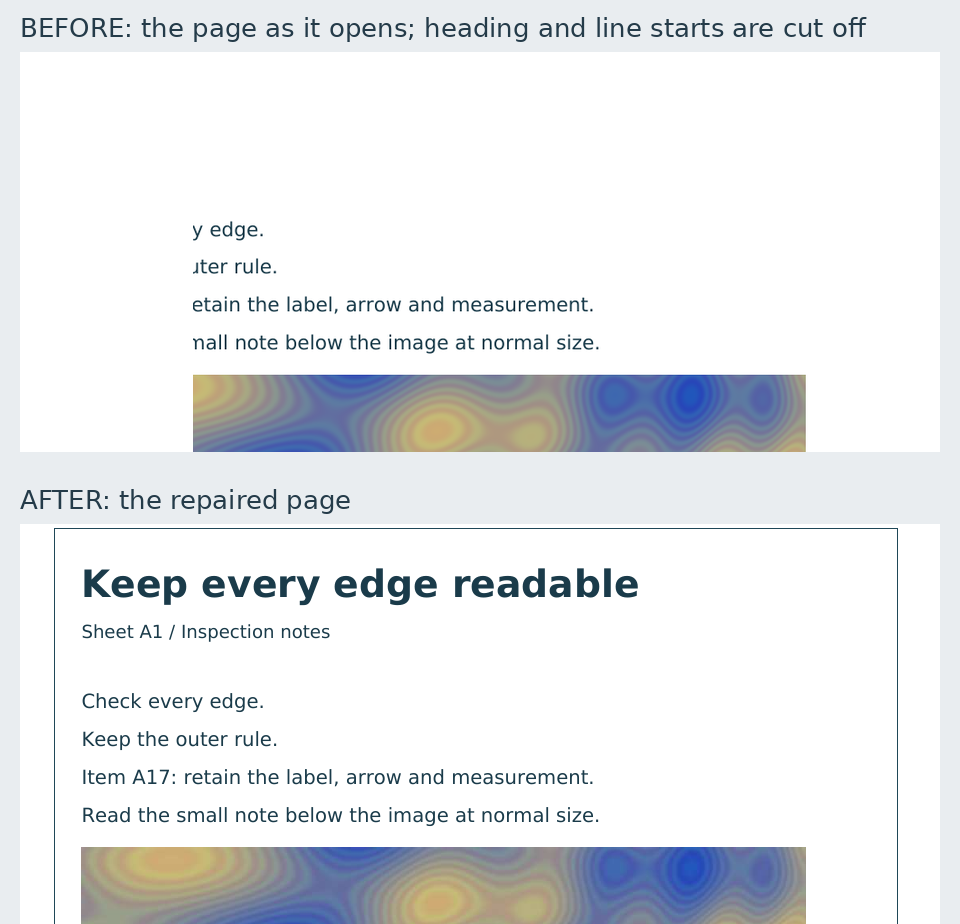

# My PDF has cut-off pages and is too large to send

**I restored the cut-off text and made this PDF [99.56% smaller](output/report.json).**

The input is a three-page PDF I generated for this case. I checked the result with Poppler, Ghostscript and qpdf; Acrobat and Microsoft Office were not tested.

<a href="output/previews/comparison-1.png"></a>

*The top of page 1 before and after, cut from the same rectangle at the same scale. [Whole-page pairs for all three sheets](output/previews/all-pages.png).*

## What was wrong

- The crop hid headings and the start of lines.
- A sideways page interrupted reading.
- Full-resolution, uncompressed images made the file bulky.

## What I did

- I recovered the content inside each original page boundary.
- I turned the text upright and fitted each page inside a safe margin.
- I reduced image size while keeping searchable text and vector diagrams.
- I compared every page and checked the small print in the rendered PDF.

## Proof and downloads

| Measured result | Before | After |
|---|---|---|
| File size | [28.40 MB](input/input.pdf) | [0.125 MB](output/fixed.pdf) |
| Pages retained | [3](output/report.json) | [3](output/report.json) |
| Text retained | [224 words](output/report.json) | [224 words](output/report.json) |
| Page layout | [Mixed crop / rotation](output/previews/all-pages.png) | [Portrait A4](output/report.json) |

Sizes use decimal MB, measured from file bytes with Python 3.11.2. The [report](output/report.json) gives exact bytes and the reduction calculation. pypdf 5.1.0 compares every word in page order, with whitespace normalised. Poppler 22.12.0 measures page text bounds and image resolution; Ghostscript 10.00.0 optimises the images; qpdf 11.3.0 checks the PDF structure.

[Download the repaired PDF](output/fixed.pdf) · [Download the original PDF](input/input.pdf) · [All pages before and after](output/previews/all-pages.png) · [Small-print detail](output/previews/detail-1.png) · [Image detail](output/previews/image-detail-3.png) · [Measurement report](output/report.json) · [Runtime](output/runtime.json) · [Claim sources](proof/claims.json)

I made the source text and graphics for this repair. The [generation recipe](source/README.md) explains the oversized export and layout faults. This reduction belongs to this file; other PDFs will differ. Images are recompressed with a small measured pixel difference, not losslessly preserved.

I checked the PDF with Poppler, Ghostscript and qpdf. Acrobat, Microsoft Office, email delivery and PDF/A certification were not tested. PDFs with annotations, forms, actions, attachments or layers need separate review; this command rejects them before repair.

## Try it yourself

Install Git and Docker, clone `https://github.com/Ardholt/doc-pipeline.git`, and open the clone. Then run:

```bash
cd pdf-layout-compression && ./run.sh
```

Open `output/fixed.pdf`. The command also produces page previews and fresh reports, without changing the input. For your own files, see the [input contract and check command](tests/README.md).

## How it is tested

[](https://github.com/Ardholt/doc-pipeline/actions/workflows/checks.yml)

The checks compare page count, every word, image count, page boundaries, embedded fonts and rendered appearance. They measure text inside the safe area and image resolution. [Deliberately damaged outputs](output/adversarial.json) must fail the same checks. The [test instructions](tests/README.md) include inspecting an existing output without rebuilding it.

Fixed price in a written scope, sent within hours

Maintained by Genco Doganay, Ardholt · [All cases](../README.md) · [MIT licence](../LICENSE)
