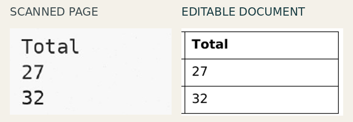

# I need 150 scanned pages made editable

**I made this generated 150-page typed scan editable and searchable, with every source page mapped: 99.813% of characters match the source text, but 203 of its 750 record and item codes in the delivered file are still wrong.**

The input is a 150-page typed scan that I generated for this case, not a camera photo. It was read with Tesseract and the result rendered in LibreOffice; Microsoft Word was not tested.

[](media/hero.png)

[150-page input manifest](source/corpus-manifest.json) · [Full scan detail](output/media/scan-page-001.png) · [Full document detail](output/media/document-page-001.png)

## What was wrong

- The source pages are images; their words cannot be searched.
- Retyping can lose item codes, punctuation and table values.
- A long document needs a clear route back to each source page.

## What I did

- I wrote the source text and rendered it as a typed scan.
- I extracted the page images and retained the raw readings.
- I rebuilt editable headings, paragraphs and simple tables.
- I compared the delivered text with the independent source and recorded the errors.

## Proof and downloads

| Measured | Raw OCR | Final DOCX |
|---|---|---|
| Characters | [99.801%](output/accuracy.json) | [99.813%](output/accuracy.json) |
| Words | [99.159%](output/accuracy.json) | [99.204%](output/accuracy.json) |
| Record and item codes wrong, of 750 | [211](proof/code-errors.json) | [203](proof/code-errors.json) |

**Read the character figure together with the code figure.** In the delivered DOCX, [203 of the 750 record and item codes are still wrong](proof/code-errors.json), on 115 of the 150 pages: 111 of 300 record codes (for example `DQ1-02` for `D01-02` on page 2), 24 of 300 first item codes (`KO11` for `K011` on page 11) and 68 of 150 second item codes (`ROO2` for `R002` on page 2). That is about 27% of the codes. The searchable PDF carries the same text, so an exact search for 83 of the 450 distinct codes finds nothing at all. In the [accuracy report](output/accuracy.json), 95 of the 150 tables differ from the reference in at least one cell. My [12 reviewed corrections](input/review.csv) fixed 8 of the wrong codes, on pages 1, 31 and 121; the other pages keep their extracted readings. The picture above shows page 1, one of those three hand-corrected pages, so it looks cleaner than most of the document. The 150 pages are a typed scan I generated, not a camera photo of paper, so these figures do not predict the result on another scan. [`tests/code_errors.py`](tests/code_errors.py) recomputes the code counts from the reference, the DOCX and the PDF.

I measured the character and word figures with the [Python edit-distance checker](source/common.py), using [Tesseract and LibreOffice versions recorded in the run](output/report.json). The reference denominators are [185,435 characters and 33,665 words](output/accuracy.json), after collapsing whitespace. Case, digits and punctuation still count. The final text has [347 character edits and 268 word edits](output/accuracy.json) relative to that reference; the remaining differences are listed by page. Percentages are rounded to three decimal places.

The [input manifest](source/corpus-manifest.json) lists every page in the [scan](input/scan.pdf). The [accuracy report](output/accuracy.json) separates raw extraction, reviewed text and text read back from the DOCX. It gives character and word edit counts, reference denominators and whitespace normalization. [Tool versions and checks](output/report.json) identify the actual applications used.

The [review record](https://github.com/Ardholt/doc-pipeline/blob/main/retype-150-pages/source/review-record.md) covers limited corrections on selected pages. The remaining pages retain their extracted readings; this is not a complete proofreading pass. The corpus uses repeated procedural instructions with varied records; the measurements do not predict accuracy on another scan.

**Downloads:** [editable DOCX](output/retyped.docx) · [searchable PDF](output/preview.pdf) · [page map](output/pages.json) · [correction and uncertainty log](output/corrections.json) · [original reference](source/reference.json).

The [figure map](output/media/figure-map.json) identifies the scan and output crops. [Page renders](output/media/contact-sheets.json) cover the delivered PDF. [Runtime](output/runtime.json) excludes setup and source authoring. [Claim evidence](proof/claims.json) maps the statements on this page to their files.

LibreOffice was used to render the DOCX. Microsoft Word was not tested. Source-page bookmarks preserve the mapping; an editable document can reflow to a different page count.

## Try it yourself

Install Git and Docker, clone [Ardholt/doc-pipeline](https://github.com/Ardholt/doc-pipeline), then run this from the repository root:

```bash
cd retype-150-pages && ./run.sh
```

Open `output/retyped.docx` or `output/preview.pdf`. The command builds the pinned container and runs offline. See [input boundaries and reproduction](source/REPRODUCING.md) for another scan, the corpus recipe and checks without conversion.

## How it is tested

[](https://github.com/Ardholt/doc-pipeline/actions/workflows/checks.yml)

- I check source order, retained OCR, literal review and actual DOCX paragraphs and table cells.
- I recompute accuracy against the independent reference and compare the searchable PDF text.
- I test missing and repeated review matches, absent review, altered text, a damaged table and reordered page markers.

[Offline page previews](https://github.com/Ardholt/doc-pipeline/blob/main/retype-150-pages/proof/page-previews/screenshots.json) use the shared GitHub frame and Pages layout. They are local renders, not captures of the published pages; CI status comes from the badge above.

Fixed price in a written scope, sent within hours

Maintained by Genco Doganay, Ardholt · [All cases](../README.md) · [MIT licence](../LICENSE)
