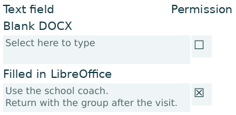

# School forms that stay in place

**I made DOCX forms with fields that survive saving.**

The input is two form definitions I wrote for this case. I filled, saved and reopened the DOCX forms in LibreOffice only; Word was not available.

<p><a href="media/hero.png"></a></p>

## What was wrong

Paper forms need clear places to type on screen.  
Typing into ordinary paragraphs can push the rest of a form down.  
Answers and selected boxes need to survive saving and reopening.

## What I did

- I built trip-permission and absence-request DOCX templates with real text and checkbox controls.
- I put the entry areas in fixed-height rows and added instructions.
- I entered multiline answers and changed checkbox states through LibreOffice, then saved, closed and reopened each form.
- I checked the reopened values, surrounding labels and PDF previews, and left a repeatable build.

## Proof and downloads

[Two forms and seven fields](output/report.json) were checked with the LibreOffice version recorded in that report. [The round-trip record](output/roundtrip.json) maps every field to its type, adjacent label and value before entry and after reopening. [The PDF measurements](output/report.json) compare blank and filled label positions using Poppler; the allowed difference is half a point.

**Download the forms:**

- Trip permission: [blank DOCX](output/trip-permission-blank.docx) · [filled DOCX](output/trip-permission-filled.docx) · [filled PDF](output/trip-permission-filled.pdf).
- Absence request: [blank DOCX](output/absence-request-blank.docx) · [filled DOCX](output/absence-request-filled.docx) · [filled PDF](output/absence-request-filled.pdf).

**See the output:** [trip permission page](output/trip-permission-filled.png) · [absence request page](output/absence-request-filled.png) · [full-size proof crop](media/hero.png), taken from the [blank](output/trip-permission-blank.pdf) and [filled](output/trip-permission-filled.pdf) PDFs rendered by LibreOffice and Poppler.

**Compatibility:** Word was not available. I exercised fields and round-tripped the DOCX files in LibreOffice. The forms are editable and are not locked; the pipeline rejects answers beyond the documented limits. The PDFs are for viewing and printing.

**How the values went in:** a scripted headless LibreOffice call entered them, not typing in the Writer window. After the save, LibreOffice does not keep all the field names, so each field is matched to the form definition by its order in the saved file and the label next to it. The text values I entered are two lines long. The limit is four lines; a five-line value is tested only as a rejection, so I have not shown that longer answers fit the fixed rows.

[Input schema and limits](INPUT.md) · [forms](input/forms.json) · [values](input/values.json) · [report](output/report.json) · [runtime](output/runtime.json) · [claim map](proof/claims.json)

## Try it yourself

Clone the repository and install Docker with a running daemon. From the clone root:

```bash
cd school-fillable-forms && ./run.sh
```

The command builds the pinned image and regenerates the forms, PDFs, previews and checks in `output/`. The document workload runs offline.

## How it is tested

[](https://github.com/Ardholt/doc-pipeline/actions/workflows/checks.yml)

The tests compare saved text, check states, field types and surrounding labels against the JSON inputs. They check fixed rows, PDF text, page geometry, embedded fonts and metadata. [Negative tests](output/rendered-negative.json) verify that damaged values, links and pages are rejected; [schema tests](output/selftest.json) cover oversized answers and invalid inputs.

After a successful build, `./run.sh --check` inspects existing outputs without converting or building again. Custom paths, including spaces, use `--input "/absolute/input directory" --output "/absolute/output directory"`. The [test entry point](tests/check.py) is included. [Page screenshots](https://github.com/Ardholt/doc-pipeline/blob/main/school-fillable-forms/output/page-previews/screenshots.json) are offline previews with the shared GitHub frame, not captures of published URLs. Live CI status comes from the badge.

Fixed price in a written scope, sent within hours

Maintained by Genco Doganay, Ardholt · [All cases](../README.md) · [MIT licence](../LICENSE)
